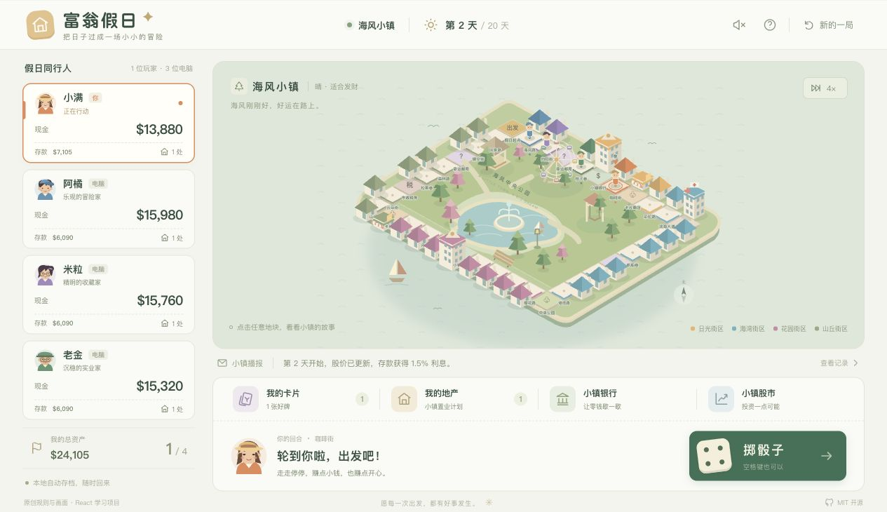

# 富翁假日 · Richman Holiday

一款用 **React + TypeScript** 编写的大富翁类单机棋盘游戏。去海风小镇，掷个骰子，买下第一块地，把一点点好运变成自己的小日子。

这是受《大富翁4》的地产经营、卡片与股市玩法启发的**原创学习版**。人物、地图、SVG 插画、文案与规则代码均为本项目新编写，规则数值经过简化，不是原版游戏或逐项兼容的移植。



也支持手机尺寸，见 [手机界面截图](docs/screenshot-mobile.jpg)。

## 试玩

- [在线试玩（创建者本人可访问的私有站点）](https://richman-holiday-zhujun.fancykid128.chatgpt.site)
- 本地启动：执行下方命令，打开终端输出的地址。

```sh
git clone https://github.com/zhujun-123/richman-holiday.git
cd richman-holiday
npm ci
npm run dev
```

需要 Node.js 22.12+，建议使用 Node.js 24。开发服务默认仅监听本机 `127.0.0.1`。

```sh
npm test          # 规则测试，包含 80 局带种子的完整对局模拟
npm run build    # TypeScript 检查与生产构建，产物在 dist/
npm run preview  # 预览生产构建
```

## 能玩什么

- 一位玩家与三位电脑，四位原创角色可选；一局 20、30 或 50 天。
- 36 格等距城市棋盘，可点击地块查看价格、归属、租金和等级。
- 掷骰、逐格移动、经过起点领奖、买地、五级升级、同街区联合收租与七折卖地。
- 遥控骰子、免租金卡、建房卡、小小财运，包含卡片商店。
- 经过银行时办理存取款、办完继续剩余步数、短局每日利息、三支虚构股票的买卖与走势。
- 机会事件、税务、公园收入、事件住院与跳过一回合。
- 自动变现与破产、住院期间暂停收租、按总资产结算、电脑自动行动与使用卡片。
- 浏览器本地自动存档、刷新继续、1×/2×/4× 速度、可选合成音效。
- 适配桌面和手机尺寸，支持键盘焦点、空格快捷键与减少动态效果偏好。

游戏没有账户、后端或真实支付，也不采集个人数据。股票与货币均为游戏内虚构数据。存档只在当前浏览器、当前站点地址内保存；清除浏览器数据会移除存档。

## 基本规则

1. 初始拥有现金 $18,000、存款 $6,000、遥控骰子和免租金卡各一张。
2. 每人每天行动一次，掷骰前可使用一张卡；经过起点获得 $3,000。
3. 空地可买，重回自己的地产可升级，最高五级。停在对手地产上时，同一街区、同一位地主的地产联合计算租金；地主住院期间不收租。
4. 经过或停在银行时可手动存取款，途中办理后继续剩余步数。余额随时可查看；短局存款每天获得 1.5% 利息，停在银行没有额外奖金。股票交易在自己回合的开始或结束阶段开放。
5. 支付不足时，依次自动取存款、卖股票、按 70% 价值卖地；仍不足则破产。
6. 到期按现金、存款、当前股票市值、地产投入价值的总和排名；最后一位未破产的玩家也会提前获胜。并列第一共同获胜。

## 从源码学什么

```text
src/
  game/
    model.ts       状态、玩家、地块和动作的类型
    data.ts        地图、角色、卡片和经济参数
    engine.ts      纯函数规则引擎、金额结算与种子随机数
    strategy.ts    电脑投资策略和下一步动作
    storage.ts     本地存档与恢复前的结构校验
  components/
    Board.tsx      原创 SVG 等距城市、建筑与角色棋子
    Avatar.tsx     原创 SVG 角色头像
    Dialog.tsx     原生 dialog 的焦点管理
    Icon.tsx       本项目绘制的图标
  App.tsx          React 界面、电脑计时器和交互
  sound.ts         Web Audio 合成音效
  styles.css      视觉样式、响应式布局与动态偏好
tests/
  engine.test.ts   规则与完整对局模拟
```

建议按 `model.ts → data.ts → engine.ts → App.tsx` 的顺序阅读。所有金额修改都在规则引擎中；界面只发送动作。重复点击、非法时机与资金不足的动作会被拒绝，而不是依赖按钮状态维护规则。

电脑策略已完整实现：根据前方可见租金保留现金、优先经营同街区地产、选择有价值的遥控骰子目标、购买有用的卡片，并在银行调整现金与存款比例。不会购买售价高于固定收益的现金卡，也不会读取未来骰子或股价。

详见 [架构与扩展](docs/ARCHITECTURE.md)、[传统规则对照](docs/RULES.md) 和 [验证记录](docs/VALIDATION.md)。银行途中办理的实测画面见 [银行截图](docs/screenshot-bank.jpg)。

## GitHub 上的大富翁4相关项目

检索与核对时间：2026-10-15。下面是查找原作相关实现时发现的项目，**本项目没有复制这些仓库的实现代码或素材**。

| 项目 | 内容 | 许可证与运行条件 |
| --- | --- | --- |
| [mytbk/rich4](https://github.com/mytbk/rich4) | 大富翁4 v3.11 的 C / 汇编逆向工程 | GPL-3.0；构建后仍需原版游戏目录 |
| [lhr0909/richman4-remastered](https://github.com/lhr0909/richman4-remastered) | 原作的 C++20 / SDL3 原生移植 | GPL-3.0-or-later；需自行提供正版游戏素材，作者说明支持 macOS / Android / iOS |
| [Infinicken/Richman4L](https://github.com/Infinicken/Richman4L) | 另一款大富翁类游戏实现 | AGPL-3.0；具体内容与运行方法见其仓库 |

原作名称、人物、画面、音频与商标仍归相应权利人。本项目不包含原版游戏文件，也与原作发行商没有隶属关系。

## 部署

`npm run build` 后，把 `dist/` 作为静态站点部署即可。构建使用相对资源路径，支持子目录部署；无服务端依赖。`.openai/hosting.json` 是本次私有试玩站点的托管标识，fork 后请使用自己的托管配置。

GitHub Actions 会运行安装、测试和构建。它不自动发布到任何账号的托管站点。

## 许可

[MIT](LICENSE)。本许可覆盖本项目原创代码、SVG 画面与文档；运行时与开发依赖保留各自的许可证。MIT 允许学习、修改、分发与商业使用，不附加“仅限非商业”的限制。
